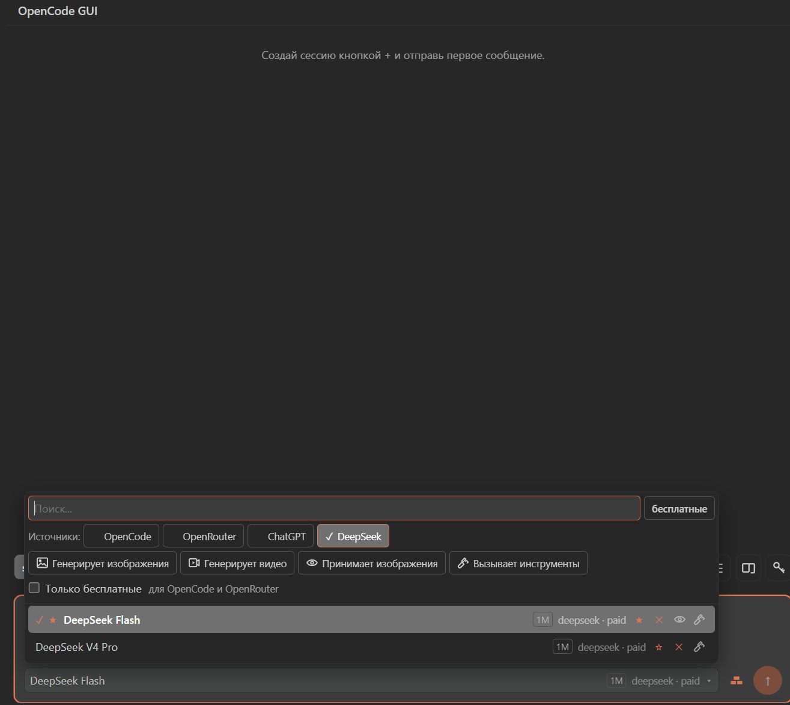
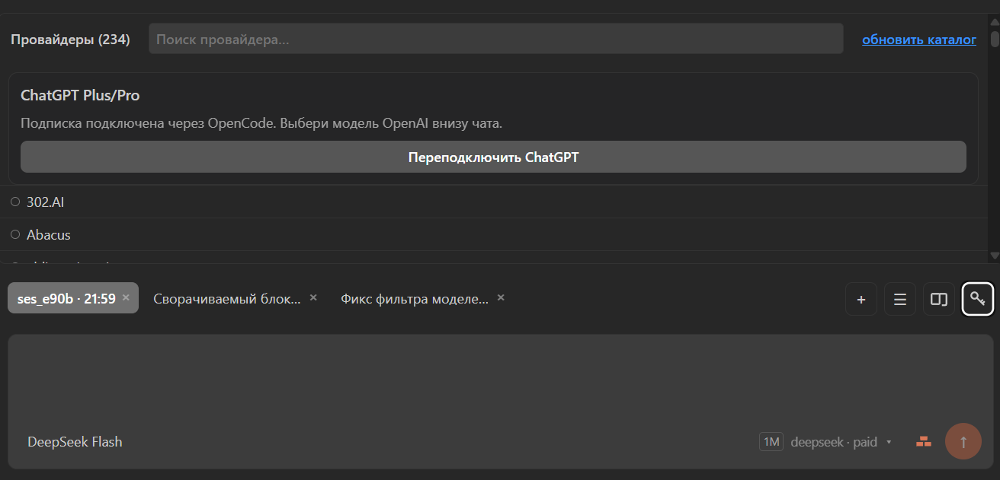

# OpenCode GUI

Чат-панель для [OpenCode](https://github.com/anomalyco/opencode) прямо в сайдбаре VS Code — в духе
Codex и Claude: стрим ответов, аппрувы разрешений, диффы с accept/reject, выбор
модели и агента, картинки из буфера и вкладки параллельных чатов.

Расширение — это GUI для локального OpenCode CLI. Оно запускает `opencode serve`
как фоновый локальный сервис и общается с ним по loopback. Запросы к
AI-провайдерам делает сам OpenCode с твоими credentials; расширение их не хранит
и никуда не отправляет.





## Возможности

- **Стрим ответов** с разбивкой на шаги: мысли и тул-коллы агента свёрнуты в
  аккордеон, текст ответа остаётся в ленте.
- **Аппрувы разрешений**: «Разрешить раз / Всегда / Отклонить». Выполнение висит,
  пока не решишь.
- **Диффы**: список изменённых файлов с патчем, «Принять / Отклонить» и откат
  хода через revert.
- **Модели и агенты**: пикер с контекстом, ценами, vision/tool-calling и
  фильтрами «только бесплатные» и источники OpenCode / OpenRouter / ChatGPT.
- **Вложения**: `@имя-файла` для контекста и `Ctrl+V` для картинки из буфера.
- **Вкладки и архив** параллельных сессий, переименование, удаление.
- **Спойлер для длинных сообщений**: полотно пользователя сворачивается до пяти
  строк и разворачивается стрелкой. Текст остаётся выделяемым и копируется
  обычным `Ctrl+C`.
- **Статус-бар** с версией сервера и текущей моделью.

## Требования

- VS Code **1.129+** (нужен нативный ESM-хост расширений).
- **OpenCode CLI v2**: `npm install -g @opencode/cli`. Проверено на `2.0.18`.
- Node.js пользователю не нужен — только для сборки из исходников.

## Установка

1. Скачай и установи VSIX из последнего GitHub-релиза.

   Windows (PowerShell):

   ```powershell
   Invoke-WebRequest https://github.com/alexdemer07-art/vscode_gui/releases/latest/download/opencode-gui.vsix -OutFile opencode-gui.vsix
   code --install-extension opencode-gui.vsix
   ```

   macOS / Linux:

   ```bash
   curl -L -o opencode-gui.vsix https://github.com/alexdemer07-art/vscode_gui/releases/latest/download/opencode-gui.vsix
   code --install-extension opencode-gui.vsix
   ```

   Или клонируй репозиторий и поставь VSIX прямо из него:

   ```bash
   git clone https://github.com/alexdemer07-art/vscode_gui.git
   code --install-extension vscode_gui/opencode-gui-0.8.16.vsix
   ```

2. Открой папку проекта в VS Code.
3. Открой панель: иконка OpenCode GUI в правом сайдбаре или `Ctrl+Alt+O`
   (`Cmd+Alt+O` на Mac).
4. Нажми `+`, напиши сообщение и отправь.

Если CLI не найден, статус-бар покажет `offline` — проверь установку и нажми
команду **OpenCode GUI: Reconnect**.

## Провайдеры и ключи

Панель «Провайдеры» умеет подключать API-ключ, OAuth и команду. Ключи и токены
принимает и хранит локальный OpenCode; расширение только передаёт их в сервис.
ChatGPT Plus/Pro подключается через «Провайдеры → Подключить ChatGPT»: вход
происходит в браузере, токены обслуживает OpenCode.

## Browser Tools (опционально)

Агент может работать с отдельным Chromium: открывать страницы, читать текст,
делать скриншоты. Инструменты выключены, пока ты сам их не включишь:

- **OpenCode GUI: Enable Browser Tools** — добавляет локальный плагин в глобальный
  конфиг OpenCode (`~/.config/opencode/opencode.jsonc`). Показывается
  подтверждение, без него ничего не пишется.
- **OpenCode GUI: Start Browser Tools** — запускает локальный browser bridge и
  изолированный Chromium (Chrome, Chromium или Edge из системы).
- **OpenCode GUI: Browser Tools Status** — показывает состояние.

Браузер использует отдельный профиль `~/.opencode-gui/browser-profile` и не
трогает твой личный профиль. `browser_click` и `browser_type` отключены до
появления `permission.assert` в OpenCode — сейчас они не могут спросить
разрешение, поэтому не выполняются.

**Локальные адреса по умолчанию закрыты.** Агент может открывать только публичные
`http(s)`-адреса: loopback, LAN и link-local заблокированы, чтобы prompt injection
со страницы не мог заставить его прочитать локальные сервисы. Если нужен
локальный дев-сервер, включи настройку
`opencode-gui.browser.allowPrivateNetworks` и перезагрузи окно — политику читает
bridge при старте.

## Приватность

- Расширение **не отправляет телеметрию**. Extension host общается только с
  локальным OpenCode; картинки и видео из результатов инструментов грузятся с
  `media.pollinations.ai`, если модель вернула такой URL. Browser Tools, если
  включены, открывают сайты в отдельном браузере — это обычные сетевые запросы
  Chromium.
- Всё, что ты пишешь в чат, уходит в OpenCode и дальше выбранному провайдеру
  модели. Так работает любой AI-чат.
- Локальный диагностический лог лежит в global storage VS Code
  (`opencode-gui-diag.log`): типы сообщений, ID, размеры и ошибки. **Текст
  промптов и секреты в него не пишутся.**
- Browser Tools передают модели только то, что агент запросил: текст страницы
  или скриншот.

## Ограничения

- Дифф и откат работают там, где сервер пишет снапшоты (git worktree). Вне git
  панель показывает «Изменений нет».
- Аппрувы приходят, если политика разрешений OpenCode говорит `ask`; при
  allow-all агент не спрашивает.
- Голосовой ввод — только системной диктовкой (`Win+H` на Windows).
- Команда **Restart Server** перезапускает общий сервис OpenCode: другие клиенты
  CLI на этой машине тоже переподключатся.

## Репозиторий

Публичный репозиторий содержит готовый билд расширения и VSIX. Исходники
разрабатываются в приватном репозитории и отдельно не публикуются.

## Лицензия

MIT. См. [LICENSE](LICENSE).
